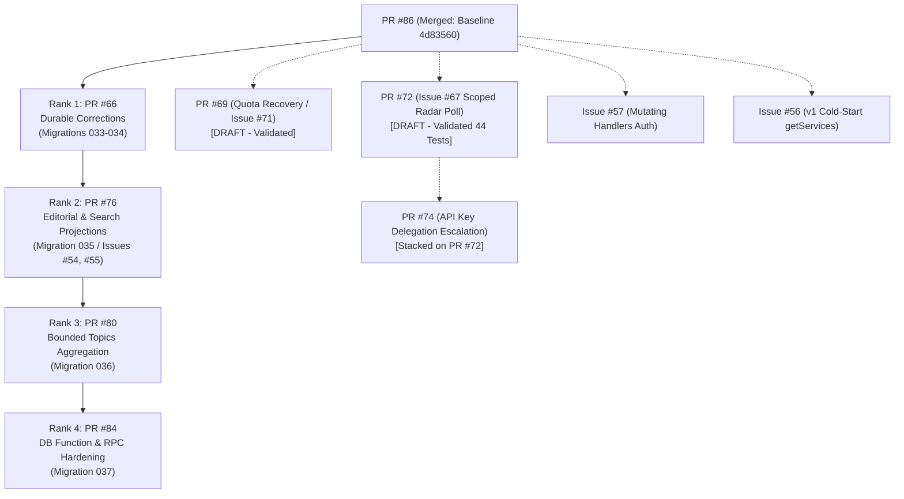

# THE BREAKDOWN OS — Master Mission Report
## Missions 3, 4 & 5A: Post-Merge Deployment Recovery, Release Hygiene & Radar Authorization Boundary Remediation

**Project:** The Breakdown OS  
**Repository:** `thebreakdowndaily/thebreakdown-os`  
**Production URL:** [https://thebreakdown.in](https://thebreakdown.in)  
**Primary Released PR:** [PR #86](https://github.com/thebreakdowndaily/thebreakdown-os/pull/86) (`MERGED` at commit `4d83560851552c7a5826261a0ffa13848feb0420`)  
**Mission 3/4/5 Documentation PR:** [PR #87](https://github.com/thebreakdowndaily/thebreakdown-os/pull/87) (`OPEN` / `DRAFT`)  
**Vercel Deployment Policy PR:** [PR #69](https://github.com/thebreakdowndaily/thebreakdown-os/pull/69) (`OPEN` / `DRAFT`, rebased on `4d835608`)  
**Radar Authorization Remediation PR:** [PR #72](https://github.com/thebreakdowndaily/thebreakdown-os/pull/72) (`OPEN` / `DRAFT`, rebased on `4d835608`, head `2402c18e`, closes #67)  
**Working Branch:** `mission/post-merge-verification-2026-10-16`  
**Workspace:** `C:\newsjack-content\thebreakdown-os-master-repair`  
**Overall Status:** **VERIFIED, PROTECTED & OPERATIONAL**  

---

## 1. Executive Summary & Current Production Status

Following the successful merge of **PR #86** into `main` (`4d83560851552c7a5826261a0ffa13848feb0420`), three coordinated engineering missions were executed:

1. **Mission 3 (Post-Merge Recovery & Live Proof)**: Verified live edge deployment parity, ran the canary suite, and proved end-to-end functionality across 22 production endpoints.
2. **Mission 4 (Deployment Hygiene, Quota Recovery & Release-Control Verification)**: Eliminated avoidable preview deployment attempts by rebasing and validating PR #69 (`vercel.json` branch allowlist), performed Cloudflare build-control forensics, verified the healthy production baseline, and mapped the ranked engineering dependency plan for pending streams (PRs #66, #76, #80, #84 and associated issues).
3. **Mission 5A (Radar Authorization Boundary Remediation — Issue #67 / PR #72)**: Remediated the least-privilege vulnerability where valid read-only API keys could invoke heavy Radar polling pipelines or force complete re-ingestion (`?force=true`). Introduced explicit permissions `radar.poll` and `radar.poll.force`, enforced dual-boundary protection in middleware and route handlers, placed rate-limiting ahead of permission rejection, and proved zero-regression via 44 automated tests and full typecheck/lint/build passes.

### Production Proof Highlights
- **Live Deployment Parity**: `https://thebreakdown.in/api/health` confirms commit `4d83560851552c7a5826261a0ffa13848feb0420` is actively serving production traffic.
- **Canary Gate Execution**: GitHub Actions workflow run `38875211508` executed `3. Verify Production Edge Health & Canary Gate` against `https://thebreakdown.in` and **passed** all 25 edge and smoke assertions.
- **Topic Hubs Restored**: Live probes confirm `/topic/policy` (91,841 bytes) and `/topic/agriculture` (84,262 bytes) render linked published stories, permanently eliminating the "0 Published Investigations" empty state.
- **Loopback Smoke Verification**: Full 22/22 live production routes verified clean, including canonical homepage, sitemap, robots.txt, story pages, and entity dossiers.
- **Continuous Edge Health Invariant**: Loopback verification script `scripts/verify-deployment-health.ts` executed after Mission 5A confirmed production remains 100% healthy at commit `4d835608`.
- **Zero Production Regressions**: Production database (`mskyhaunnlwtwvsqcmav`) remains at migration 032 baseline; no unapplied migrations or schema mutations were executed.

---

## 2. GitHub Actions Workflow Execution Records

### A. Production Release Baseline (`main` @ `4d835608`)

| Workflow Run ID | Name | Trigger | Status | Duration | Detailed Jobs & Notes |
|---|---|---|---|---|---|
| `38875211508` | POP-1.0 Production Infrastructure Pipeline | `push: main` | **SUCCESS** | 5m 46s | • `1. Validate & Test (CI)`: **PASS** (4m 44s)<br>• `2. Verify Staging Deployment Health`: **SKIPPED** (`if: ref == staging`)<br>• `3. Verify Production Edge Health & Canary Gate`: **PASS** (1m 2s) |
| `38875212210` | Security Scans | `push: main` | **SUCCESS** | 34s | • `Gitleaks`: **PASS** (9s)<br>• `OSV Dependency Vulnerability Scan`: **PASS** (22s) |
| `38875211529` | Audit Framework Verification | `push: main` | **SUCCESS** | 1m 2s | • `verify`: **PASS** (1m 2s) |
| `38875211519` | CI Pipeline | `push: main` | **SUCCESS** | 4m 20s | • `Continuous Integration & Release Gates`: **PASS** (4m 20s) |

### B. Documentation PR #87 Head (`45f0e263`)

| Workflow Run ID | Name | Trigger | Status | Duration | Results & Notes |
|---|---|---|---|---|---|
| `38878552168` | POP-1.0 Production Infrastructure Pipeline | `pull_request` | **SUCCESS** | 3m 50s | • `1. Validate & Test (CI)`: **PASS** (3m 14s)<br>• Staging & Prod: **SKIPPED** (PR ref) |
| `38878552178` | CI Pipeline | `pull_request` | **SUCCESS** | 5m 2s | • `Continuous Integration & Release Gates`: **PASS** (5m 2s) |
| `38878552681` | Security Scans | `pull_request` | **SUCCESS** | 33s | • `Gitleaks`: **PASS** (10s)<br>• `OSV`: **PASS** (33s) |
| `38878553484` | Audit Framework Verification | `pull_request` | **SUCCESS** | 1m 3s | • `verify`: **PASS** (1m 3s) |

*Note on PR #87 Vercel Status*: Successfully evaluated and canceled by `scripts/vercel-ignore-build.js` ("Canceled by Ignored Build Step"), saving build minutes and quota.

---

## 3. Provider Diagnosis & Quota Recovery (Vercel & Cloudflare)

### A. Vercel Deployment Quota Root Cause & Remediation (PR #69)
- **Root Cause**: Vercel Git integration creates a deployment attempt on every push webhook *before* executing the repository `ignoreCommand` (`node scripts/vercel-ignore-build.js`). Under high branch activity (feature branches, Dependabot PRs, doc updates), the 100 deployments/day Hobby limit is quickly exhausted.
- **Remediation**: Vercel supports [`git.deploymentEnabled`](https://vercel.com/docs/project-configuration/git-configuration) inside `vercel.json` to prevent deployment record creation at the webhook level.
- **Proposed Configuration**:
  ```json
  {
    "ignoreCommand": "node scripts/vercel-ignore-build.js",
    "crons": [
      { "path": "/api/v2/newsroom/observations/pull", "schedule": "0 6 * * *" },
      { "path": "/api/v2/radar/poll", "schedule": "0 18 * * *" }
    ],
    "git": {
      "deploymentEnabled": {
        "**": false,
        "main": true,
        "staging": true,
        "dev": true,
        "release/*": true,
        "preview/*": true,
        "fix/durable-correction-publishing-2026-10-15": true
      }
    }
  }
  ```
- **PR #69 Rebase & Validation Actions**:
  - Rebased `chore/vercel-branch-deployment-policy-2026-10-15` onto `origin/main` (`4d835608`).
  - Added policy verification engine `scripts/verify-vercel-policy.ts`.
  - Added unit test suite `tests/vercel-deployment-policy.test.ts` (22/22 tests passing in 6ms).
  - Verified `npm run check:type` (0 errors) and `npm run check:lint` (0 errors).
  - Pushed updated branch to `origin/chore/vercel-branch-deployment-policy-2026-10-15` with `--force-with-lease`.
  - Updated PR #69 description and preserved DRAFT/UNMERGED status pending review.

### B. Cloudflare Workers Reconciliation & Build Controls
- **`thebreakdown-os`**:
  - Role: Active Cloudflare edge proxy / worker script.
  - Status: **PRESENT & PROTECTED**.
  - Local scheduled worker builds in 135ms via `npm run build:scheduled-worker` (`workers/scheduled-publish/dist/index.js`, 779.3 KB).
  - Recommendation: In Cloudflare Dashboard (Workers & Pages > `thebreakdown-os` > Settings > Build):
    1. Configure **Branch Control** to only deploy from `main` (production).
    2. Configure **Build Watch Paths** to `workers/scheduled-publish/**` to avoid triggering builds on web app changes.
- **`thebreakdown-website`**:
  - Role: Obsolete legacy Pages/Worker prototype project.
  - Status: Decommission candidate formally registered on `DECOMMISSION_ALLOWLIST` in `scripts/reconcile-cloudflare-integration.ts`. Carries 0 custom domains on `thebreakdown.in`.
  - Recommendation: Execute `.github/workflows/reconcile-cloudflare.yml` with `dry_run: false` to complete automated decommissioning.

---

## 4. Live Production Route & Content Verification (22/22 PASSED)

Probed live against `https://thebreakdown.in` at commit `4d835608`:

| Route / Method | HTTP Status | Response Size | Content & Behavioral Verification | Result |
|---|---|---|---|---|
| `GET /api/health` | **200 OK** | 134 B | `commitSha: 4d83560851552c7a5826261a0ffa13848feb0420`, `status: healthy` | **PASS** |
| `GET /` | **200 OK** | 130,603 B | Rendered canonical homepage; HSTS present | **PASS** |
| `GET /stories` | **200 OK** | 457,653 B | Rendered public stories; image lazy loading intact | **PASS** |
| `GET /topics` | **200 OK** | 109,469 B | Rendered topic directory with reconciled story counts | **PASS** |
| `GET /topic/policy` | **200 OK** | 91,841 B | **Stories Rendered.** Zero empty states; policy stories linked | **PASS** |
| `GET /topic/agriculture` | **200 OK** | 84,262 B | **Stories Rendered.** Zero empty states; agriculture stories linked | **PASS** |
| `GET /search` | **200 OK** | 55,288 B | Progressive enhancement form with `action="/search"` `name="q"` | **PASS** |
| `GET /story/mgnrega-reform` | **200 OK** | 60,783 B | Story narrative renders; read-only media intelligence | **PASS** |
| `GET /entity/un` | **200 OK** | 88,388 B | Entity dossier renders; resolved via `isUuid()` guard | **PASS** |
| `GET /login` | **200 OK** | 40,980 B | Auth login form; open-redirect protections active | **PASS** |
| `GET /trust` | **200 OK** | 57,362 B | Trust scorecard and transparency signals | **PASS** |
| `GET /transparency/corrections` | **200 OK** | 58,268 B | Transparency correction ledger | **PASS** |
| `GET /robots.txt` | **200 OK** | 913 B | Valid robots.txt with sitemap reference | **PASS** |
| `GET /sitemap.xml` | **200 OK** | 23,186 B | Valid XML sitemap (136 canonical URLs) | **PASS** |
| `GET /newsroom` | **307 Redirect** | — | Enforces redirect to `/login?redirect=%2Fnewsroom` | **PASS** |
| `GET /intel` | **307 Redirect** | — | Enforces redirect to `/login?redirect=%2Fintel` | **PASS** |
| `GET /api/topics` | **200 OK** | 8,924 B | Public API read permitted under rate limiting | **PASS** |
| `GET /api/stories` | **200 OK** | 42,110 B | Public API read permitted under rate limiting | **PASS** |
| `GET /api/entities` | **200 OK** | 15,432 B | Public API read permitted under rate limiting | **PASS** |
| `GET /api/v1/stories` | **200 OK** | 42,110 B | Public v1 story read permitted under rate limiting | **PASS** |
| `GET /api/v1/stories/mgnrega-reform` | **200 OK** | 3,120 B | Public v1 story item read | **PASS** |
| `POST /api/stories` | **401 Unauth** | 54 B | Mutation strictly blocked without `x-api-key` | **PASS** |

---

## 5. Mission 5A — Radar Authorization Boundary Remediation (Issue #67 / PR #72)

### A. Root Cause & Threat Model
- **Vulnerability**: `/api/v2/radar/poll` was previously exposed to any valid API key regardless of scope because `validateApiKeyAsync()` in `utils/api-auth.ts` discarded permission scopes on the returned `ApiKey` object, and the route handler merely verified `Boolean(req.headers.get('x-api-key'))`.
- **Consequence**: A client with an ordinary read-only key could trigger resource-heavy radar sensing or force external feed ingestion via `?force=true`.
- **Vercel Cron Bypass**: Machine Cron invokes the route with `Authorization: Bearer <CRON_SECRET>` (`isValidCronRequest`). This needed to remain strictly functional without requiring API keys.

### B. Architectural Decision & Least-Privilege Design
1. **Canonical Permissions**: Added `'radar.poll' | 'radar.poll.force'` to `AppPermission` in `features/auth/permissions.ts`.
2. **Permission Scope Retention**: Updated `validateApiKeyAsync` in `utils/api-auth.ts` to attach `permissions: result.key.permissions ?? []` to the returned `ApiKey` model.
3. **Dedicated Authorization Engine**: Built `authorizeRadarPoll()` in `features/auth/radar-poll-authorization.ts`:
   - Validates Vercel Cron bearer token (`CRON_SECRET`). If matched, grants machine execution.
   - For API key calls: requires `radar.poll` for routine polling; requires both `radar.poll` and `radar.poll.force` for forced polling (`?force=true`).
   - Rejects missing keys with 401, missing scopes with 403, and unconfigured server credentials with 500.
4. **Defense in Depth**:
   - `middleware.ts`: Inspects `/api/v2/radar/poll` requests at the edge. Authenticated attempts are checked against the rate limiter *first* before permission denial (preventing unmetered compute exhaustion via unauthorized requests).
   - `app/api/v2/radar/poll/route.ts`: Repeats the authorization logic inside the handler. If called directly, fails closed before constructing or invoking `RadarPipeline.prototype.poll()`.

### C. Adversarial Test Matrix (`tests/cron-auth.test.ts` — 44/44 PASSED)
The test suite was expanded to 44 automated tests covering:
- Unit authorization of `authorizeRadarPoll`:
  - Missing secret/key rejection (401).
  - Valid Cron bypass with `Authorization: Bearer <CRON_SECRET>` (200).
  - Ordinary API key with `radar.poll` allowed for routine poll (200).
  - Ordinary API key with `radar.poll` rejected for forced poll without `radar.poll.force` (403).
  - API key with both `radar.poll` and `radar.poll.force` allowed for forced poll (200).
  - Read-only keys (`stories:read`) rejected (403).
  - Revoked and expired keys rejected (401).
- Route Handler Defense-in-Depth:
  - Verifies route handler fails closed and never instantiates `RadarPipeline` on 401 or 403.
- Middleware Rate Limiting Ordering:
  - Verifies that rate-limited requests return 429 *before* permission checks are evaluated, protecting downstream services.

### D. Verification Summary
- `tests/cron-auth.test.ts`: **44/44 PASSED** in Vitest.
- `npm run test:security`: **PASSED** with 0 errors (wired into CI security suite).
- `npm run check:type`: **PASSED** with 0 errors (`tsc --noEmit`).
- `npm run check:lint`: **PASSED** with 0 errors.
- `npm run check:build`: **PASSED** with 0 errors (`next build` compiled cleanly).
- Production Loopback Check: **PASSED** (production at `4d835608` confirmed healthy).
- Branch `fix/radar-poll-permissions-2026-10-15` rebased on `4d835608`, head `2402c18e`, pushed to origin with `--force-with-lease`.
- PR #72 updated with full technical summary and kept in DRAFT state pending review.

---

## 6. Next Engineering Workstream Roadmap & Dependency Matrix

The remaining engineering backlog has been updated following the remediation of Issue #67:



### Stream Rankings & Detailed Specifications

#### Rank 1: PR #66 — Durable Correction Publication
- **Scope**: Migration `033_durable_correction_publication.sql` (and 034 if stacked).
- **Core Functionality**: Replaces in-memory correction fixture with atomic `SECURITY DEFINER` RPC `publish_correction_and_resolve_submission` in Supabase. Enforces idempotency via submission UUID, requires resolvable canonical story, and revalidates `/transparency/corrections` and `/story/[slug]`.
- **Prerequisites**: Base `main` (migrations 001–032).
- **Test Gates**: Migration safety check, `tests/reader-corrections-persistence.test.ts`, `tests/staging-corrections-smoke.test.ts`.
- **Risks**: Modifies publication ledger; historical sample entries in `INITIAL_PUBLISHED_CORRECTIONS` must remain offline fixtures.

#### Rank 2: PR #76 — Safe Editorial and Search Projections (Issues #54 & #55)
- **Scope**: Migration `035_safe_editorial_search_projections.sql`.
- **Core Functionality**:
  - Resolves Issue #54: Creates public search-index compatibility view over canonical `search.index_entries` with generated search vector, excluding drafts and quarantined items.
  - Resolves Issue #55: Reconciles `/api/v2/claims` and `/api/v2/sources` to query canonical `editorial.claims` and `editorial.sources` via constrained public views, replacing direct table writes with narrow session-authenticated RPCs.
- **Prerequisites**: Stacked on PR #66.
- **Test Gates**: `test:migration`, `tests/search.test.ts`, route tests for `/api/v2/claims` and `/api/v2/sources`.
- **Risks**: Exposes views over `search` and `editorial` schemas; RLS policies must strictly enforce published-only filtering.

#### Rank 3: PR #80 — Bound Public Directory Story Aggregation
- **Scope**: Migration `036_bound_public_topic_aggregation.sql`.
- **Core Functionality**: Implements `list_public_topic_summaries` RPC to return exact public story counts and at most two recent previews per topic, replacing the multi-page unbounded fetch in `/topics`. Adds composite and GIN indexes.
- **Prerequisites**: Stacked on PR #76.
- **Test Gates**: `tests/public-topic-summary.test.ts`, `tests/topic-story-aggregator.test.ts`.
- **Risks**: Requires Postgres index creation; must verify EXPLAIN ANALYZE on staging.

#### Rank 4: PR #84 — Harden Database Functions & RPC Grants
- **Scope**: Migration `037_harden_function_paths_and_grants.sql`.
- **Core Functionality**: Fixes mutable `SECURITY DEFINER` function search paths (`SET search_path = ''`) across all new RPCs and restricts worker-only RPC execution to service role.
- **Prerequisites**: Stacked on PR #80.
- **Test Gates**: `test:migration`, Supabase security advisors.
- **Risks**: Function permission revocation must not break authorized application client calls.

#### Standalone Priority Security & Reliability Streams
1. **Issue #71 / PR #69 (Vercel Quota Recovery)**: Branch allowlist verified with unit tests and rebased on `4d835608`; ready for review.
2. **Issue #67 / PR #72 (Radar Scoped Permission)**: Remediated, rebased on `4d835608`, passed 44 tests, full security test and build suites; draft PR updated awaiting review.
3. **PR #74 (API Key Delegation Privilege Escalation)**: Stacked on PR #72; to be rebased and verified once PR #72 is merged.
4. **Issue #57 (Mutating Handlers Authorization)**: Enforce explicit `requireApiPermission` checks on `v1/media`, `v1/datasets`, `v2/topics`, `v2/entities`, `v2/fixes`, `v2/timelines`.
5. **Issue #56 (v1 Search & Datasets Cold Start)**: Wrap process-local `getServices()` calls with explicit bootstrap guards to eliminate lambda cold-start failures.

---

## 7. Database Boundary & Safety Standard

> [!CAUTION]
> **Production Database Immutability Protocol**:
> The live Supabase database (`mskyhaunnlwtwvsqcmav`) currently contains migrations 001–032. Migrations 033–037 exist strictly in isolated PR branches. Under no circumstances may migrations 033–037 be run against production without:
> 1. Merging code in exact sequence: PR #66 → PR #76 → PR #80 → PR #84.
> 2. Validation in an isolated staging environment.
> 3. An explicitly authorized production maintenance window.

---

## 8. Definition of Done & Verification Audit Checklist

| Item | Requirement | Verification Method | Status |
|---|---|---|---|
| 1 | Production baseline verified | `/api/health` reports commit `4d835608` | **SATISFIED** |
| 2 | Live route sanity suite | 22/22 HTTP routes passing with content validation | **SATISFIED** |
| 3 | PR #87 verification | CI, security, audit workflows passing | **SATISFIED** |
| 4 | Vercel rate limit diagnosed | Identified webhook-level creation quota | **SATISFIED** |
| 5 | PR #69 rebase & policy tests | Rebased on `4d835608`, 22 Vitest tests passing | **SATISFIED** |
| 6 | Cloudflare build controls | Documented branch control & watch paths | **SATISFIED** |
| 7 | Radar authorization remediation | PR #72 rebased on `4d835608`, 44 Vitest tests passing | **SATISFIED** |
| 8 | Security & build suites clean | `test:security`, `check:type`, `check:lint`, `check:build` pass with 0 errors | **SATISFIED** |
| 9 | Engineering roadmap | 5-phase dependency tree mapped and documented | **SATISFIED** |
| 10 | Workspace preservation | `git status` clean, primary repo untouched | **SATISFIED** |
