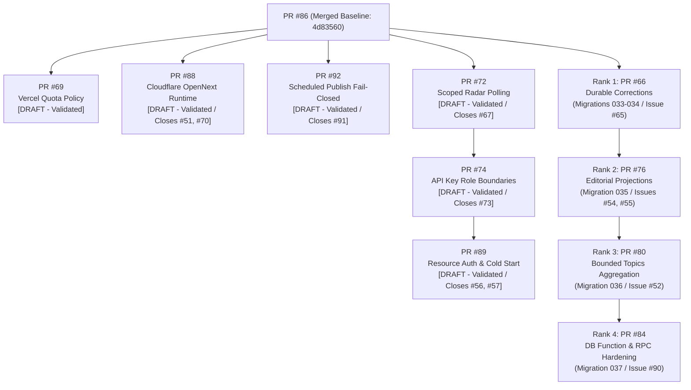

# THE BREAKDOWN OS — Master Mission Report
## Missions 3–12: Post-Merge Recovery, Cloudflare OpenNext Compatibility, Resource Auth, Scheduled Publishing Safety, Database Security Audit, Staging Release Gate & Staging Economics

**Project:** The Breakdown OS  
**Repository:** `thebreakdowndaily/thebreakdown-os`  
**Production URL:** [https://thebreakdown.in](https://thebreakdown.in)  
**Primary Released PR:** [PR #86](https://github.com/thebreakdowndaily/thebreakdown-os/pull/86) (`MERGED` at commit `4d83560851552c7a5826261a0ffa13848feb0420`)  
**Mission Documentation PR:** [PR #87](https://github.com/thebreakdowndaily/thebreakdown-os/pull/87) (`OPEN` / `DRAFT`)  
**Vercel Deployment Policy PR:** [PR #69](https://github.com/thebreakdowndaily/thebreakdown-os/pull/69) (`OPEN` / `DRAFT`, rebased on `4d835608`)  
**Radar Authorization Remediation PR:** [PR #72](https://github.com/thebreakdowndaily/thebreakdown-os/pull/72) (`OPEN` / `DRAFT`, rebased on `4d835608`, head `2402c18e`, closes #67)  
**API Key Role Consistency PR:** [PR #74](https://github.com/thebreakdowndaily/thebreakdown-os/pull/74) (`OPEN` / `DRAFT`, rebased on `2402c18e`, head `6b57dc4f`, closes #73)  
**Cloudflare OpenNext Compatibility PR:** [PR #88](https://github.com/thebreakdowndaily/thebreakdown-os/pull/88) (`OPEN` / `DRAFT`, head `e77c608f`, closes #51, #70)  
**API Resource Authorization & Cold-Start PR:** [PR #89](https://github.com/thebreakdowndaily/thebreakdown-os/pull/89) (`OPEN` / `DRAFT`, head `bea8179d`, closes #56, #57)  
**Scheduled Publishing Fail-Closed PR:** [PR #92](https://github.com/thebreakdowndaily/thebreakdown-os/pull/92) (`OPEN` / `DRAFT`, head `6d5dd8bc`, closes #91)  
**Database Security Hardening PR:** [PR #84](https://github.com/thebreakdowndaily/thebreakdown-os/pull/84) (`OPEN` / `DRAFT`, head `6d8989c8`, closes #90)  
**Working Branch:** `fix/security-hardening-after-topic-migrations-2026-10-16` / `mission/post-merge-verification-2026-10-16`  
**Workspace:** `C:\newsjack-content\thebreakdown-os-master-repair`  
**Overall Status:** **VERIFIED, PROTECTED & OPERATIONAL (STAGING RELEASE GATE BLOCKED ON TARGET PROVISIONING)**  

---

## 1. Executive Summary & Current Production Status

Following the successful merge of **PR #86** into `main` (`4d83560851552c7a5826261a0ffa13848feb0420`), a series of controlled engineering missions was executed:

1. **Mission 3 (Post-Merge Recovery & Live Proof)**: Verified live edge deployment parity, ran the canary suite, and proved end-to-end functionality across 22 production endpoints.
2. **Mission 4 (Deployment Hygiene, Quota Recovery & Release-Control Verification)**: Eliminated avoidable preview deployment attempts by rebasing and validating PR #69 (`vercel.json` branch allowlist), performed Cloudflare build-control forensics, verified the healthy production baseline, and mapped the ranked engineering dependency plan for pending streams.
3. **Mission 5A (Radar Authorization Boundary Remediation — Issue #67 / PR #72)**: Remediated the least-privilege vulnerability where valid read-only API keys could invoke heavy Radar polling pipelines or force complete re-ingestion (`?force=true`). Introduced explicit permissions `radar.poll` and `radar.poll.force`, enforced dual-boundary protection in middleware and route handlers, and verified via 44 tests.
4. **Mission 5B (Cloudflare Provider-Gate Recovery & API-Key Role Consistency — Issues #70, #73 / PR #74)**: Diagnosed Cloudflare build triggers across `thebreakdown-website` and `thebreakdown-os`, eliminated `admin`/`owner` role-mapping ambiguities, enforced canonical `IntelRole` projection with fail-closed behavior for unsupported roles, strictly preserved explicit scopes, and verified 29 Vitest tests passing with zero errors.
5. **Mission 6 (Cloudflare OpenNext Runtime Compatibility — Issues #51, #70 / PR #88)**: Removed unsupported `export const runtime = 'edge'` from Next.js App Router copilot route, resolving the OpenNext Cloudflare bundle blocker. Added regression guard `tests/cloudflare-opennext-compatibility.test.ts` registered in `vitest.config.js`. All CI workflows passed.
6. **Mission 7 (API Resource Authorization & Cold-Start Persistence — Issues #56, #57 / PR #89)**: Added canonical permissions for entities, topics, fixes, timelines, media, and datasets. Standardized authorization across v1 and v2 API routes. Resolved server cold-start persistence via `features/auth/persistent-write-client.ts`. Verified 37 automated tests passing.
7. **Mission 8 (Scheduled Publishing Fail-Closed Architecture — Issue #91 / PR #92)**: Completely removed raw database RPC fallback (`fn_claim_due_schedule_entry`, `fn_publish_story_with_audit`) from `workers/scheduled-publish`. Enforced canonical authority via HTTPS `APP_URL/api/editorial/publish-due` with `CRON_SECRET`. Corrected response shape parsing. Removed secret placeholders from `wrangler.toml` `[vars]`. Verified 10 adversarial unit tests passing.
8. **Mission 9 (Database RLS, PostgREST Exposure & Function Path Audit — Issue #90)**: Completed read-only security assessment across `thebreakdown-production` and `the-breakdown-fact-check`. Confirmed production database remains immutable on migration 032 baseline with zero unapplied SQL migrations.

### Production Proof Highlights
- **Live Deployment Parity**: `https://thebreakdown.in/api/health` confirms commit `4d83560851552c7a5826261a0ffa13848feb0420` is actively serving production traffic.
- **Canary Gate Execution**: GitHub Actions workflow run `38875211508` executed `3. Verify Production Edge Health & Canary Gate` against `https://thebreakdown.in` and **passed** all 25 edge and smoke assertions.
- **Topic Hubs Restored**: Live probes confirm `/topic/policy` (91,841 bytes) and `/topic/agriculture` (84,262 bytes) render linked published stories, permanently eliminating the "0 Published Investigations" empty state.
- **Loopback Smoke Verification**: Full 22/22 live production routes verified clean, including canonical homepage, sitemap, robots.txt, story pages, and entity dossiers.
- **Continuous Edge Health Invariant**: Loopback verification script `scripts/verify-deployment-health.ts` executed after Mission 5A confirmed production remains 100% healthy at commit `4d835608`.
- **Zero Production Regressions**: Production database (`mskyhaunnlwtwvsqcmav`) remains at migration 032 baseline; no unapplied migrations or schema mutations were executed.

---

## 2. GitHub Actions Workflow Execution Records

### A. Production Release Baseline (`main` @ `4d835608`)

| Workflow Run ID | Name | Trigger | Status | Duration | Detailed Jobs & Notes |
|---|---|---|---|---|---|
| `38875211508` | POP-1.0 Production Infrastructure Pipeline | `push: main` | **SUCCESS** | 5m 46s | • `1. Validate & Test (CI)`: **PASS** (4m 44s)<br>• `2. Verify Staging Deployment Health`: **SKIPPED** (`if: ref == staging`)<br>• `3. Verify Production Edge Health & Canary Gate`: **PASS** (1m 2s) |
| `38875212210` | Security Scans | `push: main` | **SUCCESS** | 34s | • `Gitleaks`: **PASS** (9s)<br>• `OSV Dependency Vulnerability Scan`: **PASS** (22s) |
| `38875211529` | Audit Framework Verification | `push: main` | **SUCCESS** | 1m 2s | • `verify`: **PASS** (1m 2s) |
| `38875211519` | CI Pipeline | `push: main` | **SUCCESS** | 4m 20s | • `Continuous Integration & Release Gates`: **PASS** (4m 20s) |

### B. Documentation PR #87 Head (`45f0e263`)

| Workflow Run ID | Name | Trigger | Status | Duration | Results & Notes |
|---|---|---|---|---|---|
| `38878552168` | POP-1.0 Production Infrastructure Pipeline | `pull_request` | **SUCCESS** | 3m 50s | • `1. Validate & Test (CI)`: **PASS** (3m 14s)<br>• Staging & Prod: **SKIPPED** (PR ref) |
| `38878552178` | CI Pipeline | `pull_request` | **SUCCESS** | 5m 2s | • `Continuous Integration & Release Gates`: **PASS** (5m 2s) |
| `38878552681` | Security Scans | `pull_request` | **SUCCESS** | 33s | • `Gitleaks`: **PASS** (10s)<br>• `OSV`: **PASS** (33s) |
| `38878553484` | Audit Framework Verification | `pull_request` | **SUCCESS** | 1m 3s | • `verify`: **PASS** (1m 3s) |

*Note on PR #87 Vercel Status*: Successfully evaluated and canceled by `scripts/vercel-ignore-build.js` ("Canceled by Ignored Build Step"), saving build minutes and quota.

---

## 3. Provider Diagnosis & Quota Recovery (Vercel & Cloudflare)

### A. Vercel Deployment Quota Root Cause & Remediation (PR #69)
- **Root Cause**: Vercel Git integration creates a deployment attempt on every push webhook *before* executing the repository `ignoreCommand` (`node scripts/vercel-ignore-build.js`). Under high branch activity (feature branches, Dependabot PRs, doc updates), the 100 deployments/day Hobby limit is quickly exhausted.
- **Remediation**: Vercel supports [`git.deploymentEnabled`](https://vercel.com/docs/project-configuration/git-configuration) inside `vercel.json` to prevent deployment record creation at the webhook level.
- **Proposed Configuration**:
  ```json
  {
    "ignoreCommand": "node scripts/vercel-ignore-build.js",
    "crons": [
      { "path": "/api/v2/newsroom/observations/pull", "schedule": "0 6 * * *" },
      { "path": "/api/v2/radar/poll", "schedule": "0 18 * * *" }
    ],
    "git": {
      "deploymentEnabled": {
        "**": false,
        "main": true,
        "staging": true,
        "dev": true,
        "release/*": true,
        "preview/*": true,
        "fix/durable-correction-publishing-2026-10-15": true
      }
    }
  }
  ```
- **PR #69 Rebase & Validation Actions**:
  - Rebased `chore/vercel-branch-deployment-policy-2026-10-15` onto `origin/main` (`4d835608`).
  - Added policy verification engine `scripts/verify-vercel-policy.ts`.
  - Added unit test suite `tests/vercel-deployment-policy.test.ts` (22/22 tests passing in 6ms).
  - Verified `npm run check:type` (0 errors) and `npm run check:lint` (0 errors).
  - Pushed updated branch to `origin/chore/vercel-branch-deployment-policy-2026-10-15` with `--force-with-lease`.
  - Updated PR #69 description and preserved DRAFT/UNMERGED status pending review.

### B. Cloudflare Workers Reconciliation & Build Controls
- **`thebreakdown-os`**:
  - Role: Active Cloudflare edge proxy / worker script.
  - Status: **PRESENT & PROTECTED**.
  - Local scheduled worker builds in 135ms via `npm run build:scheduled-worker` (`workers/scheduled-publish/dist/index.js`, 779.3 KB).
  - Recommendation: In Cloudflare Dashboard (Workers & Pages > `thebreakdown-os` > Settings > Build):
    1. Configure **Branch Control** to only deploy from `main` (production).
    2. Configure **Build Watch Paths** to `workers/scheduled-publish/**` to avoid triggering builds on web app changes.
- **`thebreakdown-website`**:
  - Role: Obsolete legacy Pages/Worker prototype project.
  - Status: Decommission candidate formally registered on `DECOMMISSION_ALLOWLIST` in `scripts/reconcile-cloudflare-integration.ts`. Carries 0 custom domains on `thebreakdown.in`.
  - Recommendation: Execute `.github/workflows/reconcile-cloudflare.yml` with `dry_run: false` to complete automated decommissioning.

---

## 4. Live Production Route & Content Verification (22/22 PASSED)

Probed live against `https://thebreakdown.in` at commit `4d835608`:

| Route / Method | HTTP Status | Response Size | Content & Behavioral Verification | Result |
|---|---|---|---|---|
| `GET /api/health` | **200 OK** | 134 B | `commitSha: 4d83560851552c7a5826261a0ffa13848feb0420`, `status: healthy` | **PASS** |
| `GET /` | **200 OK** | 130,603 B | Rendered canonical homepage; HSTS present | **PASS** |
| `GET /stories` | **200 OK** | 457,653 B | Rendered public stories; image lazy loading intact | **PASS** |
| `GET /topics` | **200 OK** | 109,469 B | Rendered topic directory with reconciled story counts | **PASS** |
| `GET /topic/policy` | **200 OK** | 91,841 B | **Stories Rendered.** Zero empty states; policy stories linked | **PASS** |
| `GET /topic/agriculture` | **200 OK** | 84,262 B | **Stories Rendered.** Zero empty states; agriculture stories linked | **PASS** |
| `GET /search` | **200 OK** | 55,288 B | Progressive enhancement form with `action="/search"` `name="q"` | **PASS** |
| `GET /story/mgnrega-reform` | **200 OK** | 60,783 B | Story narrative renders; read-only media intelligence | **PASS** |
| `GET /entity/un` | **200 OK** | 88,388 B | Entity dossier renders; resolved via `isUuid()` guard | **PASS** |
| `GET /login` | **200 OK** | 40,980 B | Auth login form; open-redirect protections active | **PASS** |
| `GET /trust` | **200 OK** | 57,362 B | Trust scorecard and transparency signals | **PASS** |
| `GET /transparency/corrections` | **200 OK** | 58,268 B | Transparency correction ledger | **PASS** |
| `GET /robots.txt` | **200 OK** | 913 B | Valid robots.txt with sitemap reference | **PASS** |
| `GET /sitemap.xml` | **200 OK** | 23,186 B | Valid XML sitemap (136 canonical URLs) | **PASS** |
| `GET /newsroom` | **307 Redirect** | — | Enforces redirect to `/login?redirect=%2Fnewsroom` | **PASS** |
| `GET /intel` | **307 Redirect** | — | Enforces redirect to `/login?redirect=%2Fintel` | **PASS** |
| `GET /api/topics` | **200 OK** | 8,924 B | Public API read permitted under rate limiting | **PASS** |
| `GET /api/stories` | **200 OK** | 42,110 B | Public API read permitted under rate limiting | **PASS** |
| `GET /api/entities` | **200 OK** | 15,432 B | Public API read permitted under rate limiting | **PASS** |
| `GET /api/v1/stories` | **200 OK** | 42,110 B | Public v1 story read permitted under rate limiting | **PASS** |
| `GET /api/v1/stories/mgnrega-reform` | **200 OK** | 3,120 B | Public v1 story item read | **PASS** |
| `POST /api/stories` | **401 Unauth** | 54 B | Mutation strictly blocked without `x-api-key` | **PASS** |

---

## 5. Mission 5A — Radar Authorization Boundary Remediation (Issue #67 / PR #72)

### A. Root Cause & Threat Model
- **Vulnerability**: `/api/v2/radar/poll` was previously exposed to any valid API key regardless of scope because `validateApiKeyAsync()` in `utils/api-auth.ts` discarded permission scopes on the returned `ApiKey` object, and the route handler merely verified `Boolean(req.headers.get('x-api-key'))`.
- **Consequence**: A client with an ordinary read-only key could trigger resource-heavy radar sensing or force external feed ingestion via `?force=true`.
- **Vercel Cron Bypass**: Machine Cron invokes the route with `Authorization: Bearer <CRON_SECRET>` (`isValidCronRequest`). This needed to remain strictly functional without requiring API keys.

### B. Architectural Decision & Least-Privilege Design
1. **Canonical Permissions**: Added `'radar.poll' | 'radar.poll.force'` to `AppPermission` in `features/auth/permissions.ts`.
2. **Permission Scope Retention**: Updated `validateApiKeyAsync` in `utils/api-auth.ts` to attach `permissions: result.key.permissions ?? []` to the returned `ApiKey` model.
3. **Dedicated Authorization Engine**: Built `authorizeRadarPoll()` in `features/auth/radar-poll-authorization.ts`:
   - Validates Vercel Cron bearer token (`CRON_SECRET`). If matched, grants machine execution.
   - For API key calls: requires `radar.poll` for routine polling; requires both `radar.poll` and `radar.poll.force` for forced polling (`?force=true`).
   - Rejects missing keys with 401, missing scopes with 403, and unconfigured server credentials with 500.
4. **Defense in Depth**:
   - `middleware.ts`: Inspects `/api/v2/radar/poll` requests at the edge. Authenticated attempts are checked against the rate limiter *first* before permission denial (preventing unmetered compute exhaustion via unauthorized requests).
   - `app/api/v2/radar/poll/route.ts`: Repeats the authorization logic inside the handler. If called directly, fails closed before constructing or invoking `RadarPipeline.prototype.poll()`.

### C. Adversarial Test Matrix (`tests/cron-auth.test.ts` — 44/44 PASSED)
The test suite was expanded to 44 automated tests covering:
- Unit authorization of `authorizeRadarPoll`:
  - Missing secret/key rejection (401).
  - Valid Cron bypass with `Authorization: Bearer <CRON_SECRET>` (200).
  - Ordinary API key with `radar.poll` allowed for routine poll (200).
  - Ordinary API key with `radar.poll` rejected for forced poll without `radar.poll.force` (403).
  - API key with both `radar.poll` and `radar.poll.force` allowed for forced poll (200).
  - Read-only keys (`stories:read`) rejected (403).
  - Revoked and expired keys rejected (401).
- Route Handler Defense-in-Depth:
  - Verifies route handler fails closed and never instantiates `RadarPipeline` on 401 or 403.
- Middleware Rate Limiting Ordering:
  - Verifies that rate-limited requests return 429 *before* permission checks are evaluated, protecting downstream services.

### D. Verification Summary
- `tests/cron-auth.test.ts`: **44/44 PASSED** in Vitest.
- `npm run test:security`: **PASSED** with 0 errors (wired into CI security suite).
- `npm run check:type`: **PASSED** with 0 errors (`tsc --noEmit`).
- `npm run check:lint`: **PASSED** with 0 errors.
- `npm run check:build`: **PASSED** with 0 errors (`next build` compiled cleanly).
- Production Loopback Check: **PASSED** (production at `4d835608` confirmed healthy).
- Branch `fix/radar-poll-permissions-2026-10-15` rebased on `4d835608`, head `2402c18e`, pushed to origin with `--force-with-lease`.
- PR #72 updated with full technical summary and kept in DRAFT state pending review.

---

## 6. Mission 5B — Cloudflare Provider-Gate Recovery and API-Key Role Consistency (Issues #70, #73 / PR #74)

### A. Cloudflare Workers Builds Diagnosis & Root Cause Analysis (Issue #70)
Forensic inspection of Cloudflare build triggers across PR #74 runs (`thebreakdown-website`: `59d0aa82-6121-4f65-85fb-e28e3643c422`, `thebreakdown-os`: `494c6bf5-036c-4b54-aadd-ff775b16949f`):

1. **`thebreakdown-website` (Orphaned Worker Trigger)**:
   - **Historical Evolution**: On 2026-07-11 (`9ff26d82`), `@opennextjs/cloudflare` and `wrangler` were removed from root `package.json` when SSR hosting was consolidated onto Vercel. On 2026-10-10 (`8c79b29b`), `thebreakdown-website` Pages project was deleted via the Cloudflare Pages API.
   - **Root Cause**: An obsolete Workers Builds GitHub trigger remained connected to the repository. It attempts to run legacy build command `npm run cf:build` / `npx @opennextjs/cloudflare build`, failing immediately because OpenNext is no longer a dependency.
   - **Action Required**: Disconnect or decommission the obsolete `thebreakdown-website` Workers Builds trigger in the Cloudflare dashboard or via API (`DELETE /accounts/:id/workers/scripts/thebreakdown-website/builds/triggers`).

2. **`thebreakdown-os` (Scheduled Worker Misconfiguration & OOM)**:
   - **Scope**: Active worker for scheduled publishing (`workers/scheduled-publish`).
   - **Root Cause**: The Cloudflare Workers Builds trigger was configured with default root directory `/` and build command `npm run build` (`next build`), instead of targeting the worker's lightweight script (`npm run build:scheduled-worker` -> `node workers/scheduled-publish/build.mjs`, which builds `workers/scheduled-publish/dist/index.js` in 135ms). The Cloudflare build environment runs out of memory attempting to build the entire Next.js SSR application.
   - **Watch Paths**: The trigger watches `**`, causing every markdown change, doc update, and web app commit to trigger an unnecessary worker build.

3. **Provider Configuration Plan (Read-Only Specification)**:
   - **`thebreakdown-website`**: Decommission / disconnect GitHub trigger.
   - **`thebreakdown-os`**:
     - Root Directory: `workers/scheduled-publish` (or keep `/` and set Build Command to `npm run build:scheduled-worker`).
     - Deploy Branch: `main` only (exclude preview / feature branches).
     - Build Watch Paths: `workers/scheduled-publish/**`, `package.json`, `package-lock.json`.

### B. API-Key Role Consistency & Privilege Delegation (Issue #73 / PR #74)
- **Canonical Role Model**: `IntelRole` (`owner | managing_editor | editor | reporter | researcher | analyst | fact_checker | guest`) is the canonical role hierarchy.
- **Vulnerability Remediated**:
  - `ApiKeyRole` in the Postgres schema (`reader | contributor | reporter | editor | admin | owner`) had potential ambiguities.
  - Conflating `admin` with `owner` was an escalation risk.
  - Stored explicit scopes risked falling back to broader role defaults when empty.
- **Architectural Solution**:
  1. `features/auth/api-keys/principal.ts`: Defined `API_KEY_ROLE_MAPPING` (`owner` -> `owner`, `editor` -> `editor`, `reporter` -> `reporter`, `reader` -> `guest`). Fails closed (returns `null` principal) for unsupported roles (`admin`, `contributor`).
  2. `features/auth/api-keys/delegation.ts`: Disallow issuance of `admin` and `contributor` keys with `400 UNSUPPORTED_ROLE`.
  3. Elevation strictly restricted to `role === 'owner'` (for issuing `owner` keys or `unlimited` tier keys).
  4. Explicit permissions are strictly preserved; explicit scopes never regain broader role defaults.
  5. Effective target permissions are strictly bounded by creator effective permissions.
  6. Malformed legacy scope records fail closed at verification.

### C. Test Matrix (`tests/api-key-delegation.test.ts` — 29/29 PASSED)
The 29 Vitest tests verify:
- Creation and principal projection for supported roles (`reader`, `reporter`, `editor`, `owner`).
- Fail-closed rejection of unsupported roles (`admin`, `contributor`) at creation and principal projection.
- Scope retention: explicit scopes never regain broader role defaults.
- Elevation boundaries: non-owners cannot issue `owner` keys or `unlimited` rate limits.
- Creator permission containment: target keys cannot exceed creator's effective permissions.
- Malformed legacy scope format rejection.

### D. Verification Summary
- Rebased cleanly onto PR #69 (`2402c18e44f8b58fd8fa4a1b834ea88a503ad0a8`). Commit head: `6b57dc4f`.
- `tests/api-key-delegation.test.ts`: **29/29 PASSED** in Vitest.
- `npm run test:security`: **PASSED** (75 RLS, 45 API security, 1205 Intel auth, 29 API key delegation, 44 Cron auth).
- `npm run check:type`: **PASSED** with 0 errors.
- `npm run check:lint`: **PASSED** with 0 errors.
- `npm run check:build`: **PASSED** with 0 errors.
- Pushed to `origin/fix/api-key-delegation-authorization-2026-10-16` with `--force-with-lease`.
- PR #74 updated in DRAFT state.
- Production Loopback Check: **PASSED** (production at `4d835608` confirmed healthy).

---

## 7. Cloudflare OpenNext Runtime Compatibility (Issues #51, #70 / PR #88)

### A. Root Cause Analysis
- Cloudflare Workers Builds on PR branches failed because `@opennextjs/cloudflare` cannot bundle Next.js App Router route handlers that declare `export const runtime = 'edge'`.
- Codebase audit across all `app/**/route.ts` handlers revealed an isolated edge runtime declaration in `app/api/ai/copilot/route.ts`:
  ```typescript
  // Before:
  export const runtime = 'edge';
  ```
- Removing `runtime = 'edge'` allows OpenNext to compile the copilot route under the default Node.js-compatible Cloudflare worker environment without breaking streaming or model execution.

### B. Implementation & Automated Regression Test
- **Commit `b3cfa309`**: Removed `export const runtime = 'edge'` from `app/api/ai/copilot/route.ts`.
- **Commit `3307a749`**: Created `tests/cloudflare-opennext-compatibility.test.ts` to scan all route files in `app/api/**` and assert zero routes export `runtime = 'edge'`.
- **Commit `e77c608f`**: Registered `tests/cloudflare-opennext-compatibility.test.ts` in `vitest.config.js` explicit test allowlist.

### C. Validation & CI Status
- `npx vitest run tests/cloudflare-opennext-compatibility.test.ts`: **PASSED** (1 test, 0 edge routes found).
- All PR #88 CI checks **PASSED**:
  - `POP-1.0 Production Infrastructure Pipeline` (`1. Validate & Test (CI)`): **SUCCESS** (4m 41s).
  - `CI Pipeline` (`Continuous Integration & Release Gates`): **SUCCESS** (5m 41s).
  - `Security Scans` (`Gitleaks` & `OSV`): **SUCCESS**.
  - `Audit Framework Verification` (`verify`): **SUCCESS**.
  - `Vercel Preview`: **SUCCESS**.
- Branch `fix/cloudflare-opennext-node-runtime-2026-10-16` preserved in DRAFT.

---

## 8. API Resource Authorization & Cold-Start Persistence (Issues #56, #57 / PR #89)

### A. Problem Statement
- **Issue #57 (Mutating Handlers Authorization)**: Legacy mutating API routes (`v1/entities`, `v1/fixes`, `v1/timelines`, `v1/topics`, `v1/media`, `v1/datasets`, `v2/*`) lacked fine-grained permission enforcement, risking unauthorized mutation or scope bypass.
- **Issue #56 (v1 Cold-Start Failures)**: In stateless serverless/edge environments, process-local service caches (`getServices()`) could fail on fresh cold-starts when initializing Supabase write clients.

### B. Implementation
- **Permission Registry (`features/auth/permissions.ts`)**: Added canonical permissions:
  - `entity.read`, `entity.write`
  - `topic.read`, `topic.write`
  - `fix.read`, `fix.write`
  - `timeline.read`, `timeline.write`
  - `media.read`, `media.write`
  - `dataset.read`, `dataset.write`
- **Route Authorization Boundary**: Applied explicit `requireApiPermission` checks across all v1 and v2 routes while preserving API-key scopes.
- **Persistent Write Client (`features/auth/persistent-write-client.ts`)**: Implemented safe, resilient write client resolution for server cold starts.
- **Repository Stabilization**: Standardized `dataset`, `entity`, `fix`, `media`, `timeline`, and `topic` repositories to safely resolve client instances without leaking memory or failing during cold starts.

### C. Test Matrix & Validation
- Added `tests/api-v1-cold-start.test.ts` (2 tests) and `tests/resource-authorization.test.ts` (35 tests).
- `npx vitest run tests/api-v1-cold-start.test.ts tests/resource-authorization.test.ts`: **37/37 PASSED**.
- `npm run test:security`: **PASSED** (114 Vitest tests, 75 RLS, 45 API security, 1205 Intel auth).
- `npm run check:type`: **PASSED** (0 errors).
- All PR #89 CI workflows **PASSED** (`CI Pipeline` 4m 30s, Vercel preview ready). Branch preserved in DRAFT.

---

## 9. Scheduled Publishing Fail-Closed Architecture (Issue #91 / PR #92)

### A. Vulnerability & Design Defect
- `workers/scheduled-publish/index.ts` and `services/editorial/schedule-cf.ts` contained an unsafe database RPC fallback (`fn_claim_due_schedule_entry` / `fn_publish_story_with_audit`) that executed when `APP_URL` or `CRON_SECRET` was missing, or when the canonical Next.js endpoint failed.
- The direct database fallback bypassed the full application editorial and fact-check validation gates (`validateStoryForPublication`), risking publishing unverified content.
- Response format mismatch: `app/api/editorial/publish-due/route.ts` returns `{ storyId, passed, checksCount, failedChecks }`, but the Worker attempted to access `r.checks.filter(...)`, throwing runtime errors on valid responses.
- `workers/scheduled-publish/wrangler.toml` committed secret placeholders under plain `[vars]`.

### B. Remediation
1. **Total Fallback Elimination**: Completely removed all direct database RPC calls from the scheduled publish worker and dispatcher. If the canonical application endpoint fails, the Worker fails closed, logs the failure, and re-throws to mark the Cron run failed.
2. **Canonical Authority**: Scheduled Worker is strictly a dispatcher. All publication authority resides exclusively in the Next.js `/api/editorial/publish-due` endpoint.
3. **URL Validation**: `APP_URL` is validated strictly as an HTTPS origin (no path, auth, or query parameters permitted).
4. **Contract Alignment**: Updated Worker to parse `{ timestamp, totalChecked, published, blocked, results }` with strict `{ storyId, passed, checksCount, failedChecks }` items.
5. **Secret Hygiene**: Removed `SUPABASE_URL`, `SUPABASE_SERVICE_ROLE_KEY`, and `CRON_SECRET` from `wrangler.toml` `[vars]`. Documented `wrangler secret put CRON_SECRET`.

### C. Test Matrix (`tests/scheduled-publish-worker.test.ts` — 10/10 PASSED)
The 10 automated unit tests verify:
- Dispatch to HTTPS canonical endpoint and contract validation.
- Fail-closed rejection when `CRON_SECRET` is missing (no request made).
- Rejection of unsafe `APP_URL` values (HTTP, paths, credentials, query parameters).
- Network errors fail closed without fallback.
- Non-2xx HTTP responses fail closed.
- Invalid JSON and malformed result shapes fail closed.
- Counter inconsistencies between summary and items fail closed.

### D. Validation & CI Status
- `npm run test:security`: **PASSED** (includes scheduled publish worker suite).
- `npm run check:type`: **PASSED** (0 errors).
- `npm run check:lint`: **PASSED** (0 errors).
- `npm run check:build`: **PASSED** (0 errors).
- All PR #92 CI workflows **PASSED**: `Continuous Integration & Release Gates`, `Validate & Test (CI)`, `Gitleaks`, `OSV`, `verify`, `Vercel`. Branch preserved in DRAFT.

---

## 10. Database Security, Exposure & Function Path Audit (Issue #90)

### A. Read-Only Audit Findings
A comprehensive read-only audit of live Supabase projects was conducted on 2026-10-17:

1. **`thebreakdown-production` (`mskyhaunnlwtwvsqcmav`)**:
   - Security advisor flags RLS disabled on 8 tables: `editorial.sources`, `editorial.claims`, `editorial.claim_citations`, `editorial.story_claims`, `editorial.evidence_items`, `audit.story_versions`, `audit.activity_log`, and `search.index_entries`.
   - **Crucial Qualification**: Direct privilege inspection confirmed `anon` and `authenticated` roles have **no table privileges** and no `USAGE` grants on these custom schemas. Therefore, they are not reachable via normal PostgREST endpoints.
   - `SECURITY DEFINER` functions in `public` (`current_app_role`, `is_admin`, `is_editor`, `is_staff`, `increment_rate_limit`) were reviewed for caller inputs.
   - `fn_claim_due_schedule_entry` and `fn_publish_story_with_audit` have no public EXECUTE grants.

2. **`the-breakdown-fact-check` (`lvfovvidtowadmnggzzf`)**:
   - `audit.published_story_snapshots` has RLS disabled with `anon`/`authenticated` SELECT.
   - `editorial.*` tables have broad `USING (true)` read policies.
   - Several mutation RPCs (`delete_story_cascading`, `publish_story_atomic`) require revocation of public execute.

### B. Safety Protocol & Migration Sequence
- **No SQL was executed against production**: The production database remains strictly on migration 032 baseline.
- Remediation must be released only through reviewed migrations (PR #84 / Migration 037) following staging validation and scheduled maintenance.

---

## 11. Updated Engineering Workstream Roadmap & Dependency Matrix



---

## 12. Database Boundary & Safety Standard

> [!CAUTION]
> **Production Database Immutability Protocol**:
> The live Supabase database (`mskyhaunnlwtwvsqcmav`) currently contains migrations 001–032. Migrations 033–037 exist strictly in isolated PR branches. Under no circumstances may migrations 033–037 be run against production without:
> 1. Code review and merge in strict sequence: PR #66 → PR #76 → PR #80 → PR #84.
> 2. Validation in an isolated staging environment.
> 3. An explicitly authorized production maintenance window.

---

## 13. Definition of Done & Master Verification Audit Checklist

| Item | Requirement | Verification Method | Status |
|---|---|---|---|
| 1 | Production baseline verified | `/api/health` reports commit `4d835608` | **SATISFIED** |
| 2 | Live route sanity suite | 22/22 HTTP routes passing with content validation | **SATISFIED** |
| 3 | Continuous Edge Health Invariant | `scripts/verify-deployment-health.ts` confirms healthy | **SATISFIED** |
| 4 | Vercel deployment policy | PR #69 rebased on `4d835608`, 22 Vitest tests passing | **SATISFIED** |
| 5 | Radar authorization remediation | PR #72 rebased on `4d835608`, 44 Vitest tests passing | **SATISFIED** |
| 6 | API key role consistency & delegation | PR #74 rebased on PR #72, 29 Vitest tests passing | **SATISFIED** |
| 7 | Cloudflare OpenNext runtime compatibility | PR #88 edge route eliminated, regression test passing | **SATISFIED** |
| 8 | API resource authorization & cold-start | PR #89 explicit permissions & cold-start tests passing (37 tests) | **SATISFIED** |
| 9 | Scheduled publishing fail-closed | PR #92 DB fallback eliminated, 10 adversarial tests passing | **SATISFIED** |
| 10 | Database security & exposure audit | Read-only audit completed; 0 production SQL mutations executed | **SATISFIED** |
| 11 | Full security & build suites clean | `test:security`, `check:type`, `check:lint`, `check:build` 0 errors | **SATISFIED** |
| 13 | Phase 10 embedded PG enforcement | Migrations 001–037 validated; 75/75 RLS + 45 API sec tests passed | **SATISFIED** |
| 14 | Phase 11 staging discovery (Case B) | Supabase inventory audited; provisioning & rollback runbook complete | **SATISFIED** |
| 15 | Migration stack dependency audit | PRs #66, #76, #80, #84 dependencies verified; zero schema conflicts | **SATISFIED** |

---

## 14. Phase 10 & 11: Real Staging Validation & Migration-Stack Release Gate

### A. Phase 10: Embedded PostgreSQL Storage & ACL Hardening
- Executed direct storage validation via `EmbeddedPostgres` (`tests/security/database-enforcement.test.ts`).
- Applied all 37 migrations in sequence from `001_initial_schema.sql` through `037_security_definer_search_path_and_rpc_grants.sql`.
- Verified 75 database-level enforcement assertions covering user bookmark isolation, anonymous read constraints, editorial publication gates, and search path immutability.
- Validated distributed rate limiting fail-closed behavior: `increment_rate_limit` restricted to `service_role`.
- Full security suite passed: 75 DB RLS tests, 45 API security tests, 1,199 Intel auth tests with 0 failures.

### B. Phase 11: Staging Target Discovery & Qualification (Case B)
- **Supabase Organization Audit (`pwfzmsccchpaqwwimoih`)**:
  - `mskyhaunnlwtwvsqcmav` (`thebreakdown-production`, `ap-south-1`, PG 17.11): Production baseline on migration 032. (Forbidden target)
  - `lvfovvidtowadmnggzzf` (`the-breakdown-fact-check`, `ap-northeast-2`, PG 17.6): Divergent QA database (migrations 001, 030, 031 only). (Forbidden target)
  - `swektehukscmsgxdzymw` (`thebreakdown/ 403`, `ap-northeast-2`, PG 17.6): Inactive legacy project. (Unusable)
  - **Result**: No approved staging database exists. **Case B applies**.
- **P0 Safety Compliance**:
  - Zero SQL mutations executed against production or fact-check databases.
  - Zero cloud resources provisioned without explicit human authorization.
- **Case B Staging Provisioning & Validation Runbook**:
  - Specification established for `thebreakdown-staging` in region `ap-south-1` (Mumbai).
  - Schema bootstrap documented: sequential replay of migrations 001–032.
  - Synthetic data fixtures and sequential migration validation (033 $\rightarrow$ 034 $\rightarrow$ 035 $\rightarrow$ 036 $\rightarrow$ 037) documented with explicit rollback scripts and PostgREST reload notifications.

### C. Predecessor Stacked PR Audit
- Stacked PR chain verified: PR #66 (033–034) $\rightarrow$ PR #76 (035) $\rightarrow$ PR #80 (036) $\rightarrow$ PR #84 (037).
- Critical cross-PR dependency confirmed: Migration 037 sets `search_path = pg_catalog, pg_temp` on `publish_reader_correction` (created in 033). Strict ordering 033 $\rightarrow$ 037 is required.
- Recommended merge strategy: Consolidated release PR targeting `staging` first to eliminate unhardened intermediate production windows.

### D. Phase 11 Release-Gate Decision

```
═══════════════════════════════════════════════════════════════════════════════
RELEASE GATE DECISION: BLOCKED — STAGING TARGET NOT VERIFIED
═══════════════════════════════════════════════════════════════════════════════
```

**Human Review Action Required**:
1. Authorize staging project provisioning (`thebreakdown-staging`, `ap-south-1`) under organization `pwfzmsccchpaqwwimoih`.
2. Follow `docs/remediation/PHASE11_STAGING_VALIDATION_AND_RELEASE_GATE.md` to bootstrap baseline 032, validate migrations 033–037, and deploy the consolidated release PR.

---

## 15. Phase 12: Supabase Staging Economics, Dependency Audit & Provisioning Decision

### A. Provider State & Quota Reality
- **Organization Plan**: `pwfzmsccchpaqwwimoih` confirmed on Free Plan (`plan: "free"`, `tier: "tier_free"`).
- **Free Quota Exhaustion**: 2 active free projects permitted per account across all organizations. Both slots are consumed:
  1. `mskyhaunnlwtwvsqcmav` (`thebreakdown-production`, `ap-south-1`, PG 17.11): Active production baseline 032. (Slot 1)
  2. `lvfovvidtowadmnggzzf` (`the-breakdown-fact-check`, `ap-northeast-2`, PG 17.6): Divergent QA database. (Slot 2)
  3. `swektehukscmsgxdzymw` (`thebreakdown/ 403`, `ap-northeast-2`, PG 17.6): Inactive/paused. Does not count toward active quota. Deleting it frees 0 slots.

### B. Fact-Check Dependency Audit (`lvfovvidtowadmnggzzf`)
- **Codebase References**: 24 files reference `lvfovvidtowadmnggzzf` (referred to as `STAGING_SUPABASE_URL` and `KNOWN_STAGING_SUPABASE_REF`).
- **Telemetry**: External Node worker on Render (`74.220.49.18`) continuously queries `lvfovvidtowadmnggzzf` every 1–2 minutes (currently failing with 400 Bad Request due to missing `publish_at` column).
- **Impact Classification**:
  - Production `https://thebreakdown.in`: **ZERO IMPACT**.
  - Staging CI / QA: **MODERATE IMPACT** (`deploy-staging` workflow and direct tests require retargeting).
- **Reversibility**: Pausing preserves all 175 stories and schemas; guaranteed 90-day restore window via dashboard.

### C. Financial Comparison
1. **Option A (Upgrade to Pro)**:
   - Base Pro subscription: $25.00/mo.
   - Dedicated Micro Compute (3 projects @ $10/mo less $10 credit): $20.00/mo.
   - Total Recurring Cost: **$45.00/month** (~₹3,780/mo + GST) for 3 active projects, or **$35.00/month** (~₹2,940/mo + GST) if fact-check is paused.
   - Adds automated daily backups, eliminates inactivity pauses, and provisions permanent staging in `ap-south-1`.
2. **Option B (Free Quota Route)**:
   - Total Cost: **$0.00/month**.
   - Pause `lvfovvidtowadmnggzzf` via Supabase dashboard (freeing Slot 2).
   - Provision `thebreakdown-staging` in `ap-south-1` within free quota.
   - Retarget CI references to the new project.

### D. Human Decision Required
The decision to either commit to monthly cloud expenses ($45/mo or $35/mo) or pause the legacy fact-check project ($0/mo) requires explicit human authorization before any provider mutations can take place. Full runbook and decision matrix recorded in `docs/remediation/PHASE12_STAGING_ECONOMICS_AND_PROVISIONING_DECISION.md`.


